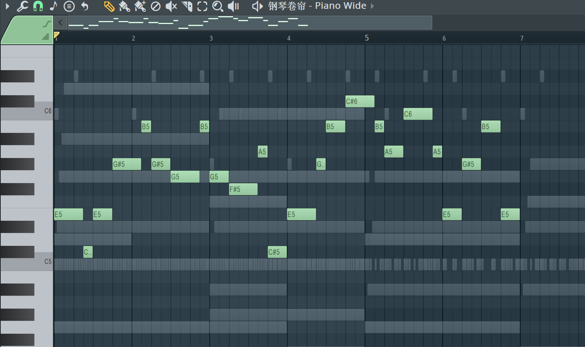

<p align="center">
  
</p>

<p align="center">
  <b>Write an 8-bar melody into FL Studio from a natural-language idea.</b><br>
  DeepSeek Harness → FL Studio Piano Roll, with three MCP tools.
</p>

<p align="center">
  <b>English</b> · <a href="README.zh-CN.md">简体中文</a>
</p>

<p align="center">
  <a href="https://github.com/q6y6y6/dsh-whalesong-fl"></a>
  
  
  
  
  
</p>

---

## What it does

You describe the melody you want. DSH resolves the target channel, composes in
the reference style, and writes the notes into the focused FL Studio Piano Roll.

- **Target-aware** — refuses to write unless the focused Piano Roll belongs to
  the channel you named.
- **One batch** — the whole 8 bars go in one call, with a backup and a
  note-count postcondition.
- **No focus stealing** — the Piano Roll trigger is posted directly to FL's PID;
  DSH normally stays in front.
- **Three tools only** — `melody_context`, `melody_write`, `melody_restore`
  (≈1.4 KB of schemas).



<sub>A corrected 6/8 draft in the `Piano Wide` channel: 24 notes, C#4–C#5,
A–G#m–G–F#m–E descent. No mixing, plugins, Playlist, or render.</sub>

## Requirements

| | |
|---|---|
| OS | macOS (validated on macOS 27, Apple silicon) |
| DAW | FL Studio 2026 (26.1.7 validated; older builds may work) |
| Python | 3.10+ (3.12 recommended) with [`uv`](https://github.com/astral-sh/uv) |
| MIDI | One IAC bus enabled in Audio MIDI Setup |
| Host | DeepSeek Harness with MCP support |

## Quick start

```bash
git clone https://github.com/q6y6y6/dsh-whalesong-fl.git
cd dsh-whalesong-fl

uv venv .venv --python 3.12
.venv/bin/python scripts/setup.py
.venv/bin/python scripts/deploy_controller.py --dry-run
.venv/bin/python scripts/deploy_controller.py
.venv/bin/python scripts/doctor.py --live
```

`setup.py` installs the bridge and the three-tool server, then writes the DSH
bundle with absolute paths for this checkout.

## FL Studio setup

1. **Enable the IAC bus** — Audio MIDI Setup → Window → Show MIDI Studio → IAC
   Driver → *Device is online*.
2. **Select the controller** — `Options → MIDI Settings → Input`: enable the IAC
   bus, set `Controller type = FLStudioMCP`.
3. **Arm the Piano Roll script** — open the target channel's Piano Roll →
   `Scripts → ComposeWithLLM` (once).
4. **Reload after upgrades** — after deploying a new controller, re-select
   `FLStudioMCP` in MIDI Settings so FL loads the new script. This also enables
   the controller's `app.getContext` (caption, pattern, tempo, meter).

> Use a disposable project for experiments. The repo's tests use `test project`.

## DSH setup

`packages/dsh-bundle/cordis.patch.yml` adds the MCP server:

```yaml
- insert:
    - id: fl-studio-mcp
      name: '@deepseek-ai/dsh-mcp-client'
      config:
        serverName: fl
        transport: stdio
        command: /absolute/path/to/.venv/bin/python
        args: ['-m', 'fl_melody.server']
        cwd: /absolute/path/to/dsh-whalesong-fl
        toolCallTimeoutMs: 30000
        failOnStartupError: false
```

Install the bundle through the DSH Plugins page, or append the generated block
to your profile. `scripts/setup.py --install-profile` does this when the entry
is absent (it backs up the profile first). The tools appear as
`mcp__fl__melody_context`, `mcp__fl__melody_write`, and
`mcp__fl__melody_restore`.

## Usage

Open the target channel's Piano Roll, then ask in DSH:

> I created a **Piano Wide** channel. Write an 8-bar melody in it, in the style
> of JVKE's “golden hour”.

What happens:

1. `melody_context("Piano Wide")` checks the target, current notes, pattern,
   tempo, and meter.
2. DSH composes in the reference style. For *golden hour*: E major, 6/8,
   63 dotted-quarter BPM, `beats_per_bar=3`.
3. `melody_write` backs up the Piano Roll, writes all notes in one call, and
   verifies the note-count delta.
4. DSH reports the channel, pattern, bars, note count, pitch range, and
   `backup_id`. No audition, mixing, plugins, Playlist, or render.

You can also smoke-test the bridge:

```bash
.venv/bin/python scripts/melody_smoke.py --channel "Piano Wide"
```

## Tools

| Tool | Purpose |
|---|---|
| `melody_context(channel)` | target/readiness, pattern, tempo, meter, note summary |
| `melody_write(channel, notes, mode, bars, beats_per_bar)` | backup, append/replace, verify |
| `melody_restore(backup)` | restore one write |

Notes are `{midi, start, duration, velocity}` in **quarter-note beats**.
`bars` defaults to 8; `beats_per_bar` is 4 for 4/4 and 3 for 6/8. `mode`
defaults to `append`; `replace` clears the target first. Backups live in
`backups/melody/` and are returned as a `backup_id`.

## How it works

```text
DSH skill: fl-melody
  → fl-melody MCP server (3 tools)
    → fl-studio-bridge (MIDI command file + trigger note)
      → device_FLStudioMCP.py inside FL Studio
        → ComposeWithLLM.pyscript in the focused Piano Roll
```

The write is one JSON request. The trigger is Cmd+Opt+Y posted to FL's PID;
the server then checks that the request was consumed and the state file
changed. A failed postcondition keeps the backup and reports failure instead of
claiming success.

## Scope

v0 is intentionally melody-only. It does **not**:

- mix, route, or automate the mixer;
- load plugins or create channels;
- place or edit Playlist clips;
- save the project, set tempo/meter, or render audio;
- audition the result.

A 6/8 melody written into a 4/4 project displays as six 4/4 bars. Set the
project meter and tempo in FL for the intended feel.

## Troubleshooting

| Symptom | Fix |
|---|---|
| `Piano Roll is not focused` / caption mismatch | Open the target channel's Piano Roll and retry. Do not write into another channel. |
| `the Piano Roll script did not consume the request` | Select `Scripts → ComposeWithLLM` once, then retry. |
| `No channel matching "Piano"` | Check the exact channel name; the tool returns near matches. |
| `connected: false` | Check FL is running, the IAC input is enabled, and `Controller type = FLStudioMCP`. |
| `app.getContext` unavailable | Re-select `FLStudioMCP` in MIDI Settings; the server falls back to OCR until then. |
| Write is too fast/slow for the reference | Set FL's project tempo and meter; the melody tools do not change them. |

Run `.venv/bin/python scripts/doctor.py --live` for a full check.

## Repo layout

```text
packages/fl-melody/   3-tool MCP server
packages/fl-v0/       MIDI + Piano Roll bridge (controller, pyscript, utils)
packages/dsh-bundle/  DSH profile patch, icon, locale
.dsh/skills/          fl-melody workflow and style guidance
scripts/              setup, deploy_controller, doctor, melody_smoke, OCR helper
docs/                 architecture and v0 scope/evidence
assets/               banner and demo image
archive/              deferred kernels and old docs (gitignored)
```

## Credits

The FL-side bridge is based on
[karl-andres/fl-studio-mcp](https://github.com/karl-andres/fl-studio-mcp)
(MIT). The PostFader fork, the 57-tool server, and the mixing/Playlist work are
archived under `archive/` and are not part of v0.

## License

MIT — see [LICENSE](LICENSE).
